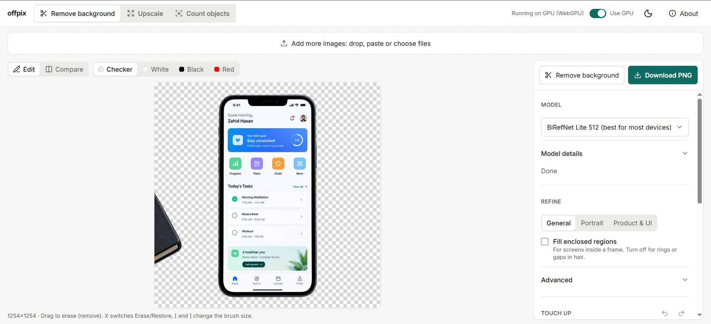

# offpix

Image tools that run in the browser: background removal, upscaling and object counting.



## What it does

offpix runs ONNX models in Web Workers with ONNX Runtime Web (WebGPU where available, otherwise WASM). Images never leave the page, and there is no backend. The background remover exports transparent PNGs and offers edge refinement, a touch-up brush and batch export. The upscaler does 2x and 4x in tiles. The counter detects the 80 COCO object types and lets you correct the count by hand.

## Requirements

- Node 22 or later, and pnpm 12 (`corepack enable` picks up the version pinned in `package.json`).
- Chromium for the end-to-end tests: `pnpm exec playwright install chromium`.
- Python 3 only to rebuild the BiRefNet export (`scripts/export-birefnet.py`; steps in `release-assets/RELEASE-ASSETS.md`, kept locally, not in git).

## Quick start

```
pnpm install                 # also copies the ONNX Runtime files into public/ort
pnpm download:models         # downloadable models, verified by sha256 (about 330 MB)
pnpm dev                     # http://localhost:5173
pnpm build && pnpm preview   # production build, http://localhost:4173
pnpm build:pages             # the Cloudflare Pages profile that gets deployed
```

BiRefNet Lite 512 is our own export and cannot be downloaded. Restore it from the local release parts with `node scripts/release-models.mjs fetch --from release-assets`, or from the published release. Without it the app uses the next model that can run on the device.

## Deployment

Pushing to `main` runs `.github/workflows/deploy.yml`, which builds the Pages profile and uploads it to the Cloudflare Pages project `offpix` (repository secrets `CLOUDFLARE_API_TOKEN` and `CLOUDFLARE_ACCOUNT_ID`). It needs the release `models-v1` with the BiRefNet Lite 512 parts (`release-assets/*.part*`, `*.parts.json`).

## Tests

```
pnpm typecheck && pnpm lint
pnpm test                    # unit and engine tests (vitest)
pnpm test:e2e                # Playwright: dev server, mobile, production and Pages builds
pnpm check:notices
pnpm build:pages && pnpm check:pages   # Cloudflare Pages file limits
```

The object-count tests need a street photo at `tests/e2e/fixtures/street.jpg`, which is not in the repo (any photo with about 10 people, a car and traffic lights). Without it they are skipped.

## Models

| Model | Tool | Size | Licence |
|---|---|---|---|
| BiRefNet Lite 512 (our export) | Remove background | 89 MB (CPU) / 173 MB (GPU) | MIT |
| BiRefNet Lite 1024 (our export, GPU only) | Remove background | 173 MB | MIT |
| ISNet general use | Remove background | 170 MB | Apache-2.0 / MIT |
| U2-Net portable | Remove background | 4.4 MB | Apache-2.0 / MIT |
| Real-ESRGAN general x4v3, x2plus, x4plus | Upscale | 4.6 / 64 / 64 MB | BSD-3-Clause |
| YOLOX Nano, Tiny | Count objects | 3.5 / 19 MB | Apache-2.0 |

The app offers only the models the device can run and picks the best one: BiRefNet Lite 512 where it fits, otherwise ISNet (`src/engine/tiers.ts`). Sources, pinned versions and hashes are in `src/models/manifest.json`; licence texts are in [THIRD_PARTY_NOTICES.md](THIRD_PARTY_NOTICES.md).

## Privacy

All processing happens on the device; models are served from the app's own origin, checked against their sha256 and cached for offline use. There are no analytics or third-party requests, and the end-to-end tests fail on any request to another origin.

## Known limitations

- Safari is untested: Playwright's WebKit on Windows cannot decode images in this app.
- `navigator.deviceMemory` exists only in Chromium, so the low-memory model choice does not apply in Firefox and Safari.
- fp16 models are not used on WebGPU (wrong results in ONNX Runtime Web 1.30); BiRefNet Lite 1024 needs a strong GPU.
- Fine hair over a backdrop of a similar colour is only partly cleaned up.
- The Pages build ships only the smaller models and the WASM runtime, because of the 25 MiB file limit.

## License

Code: [MIT](LICENSE). Models and third-party code keep their own licences ([THIRD_PARTY_NOTICES.md](THIRD_PARTY_NOTICES.md)).
